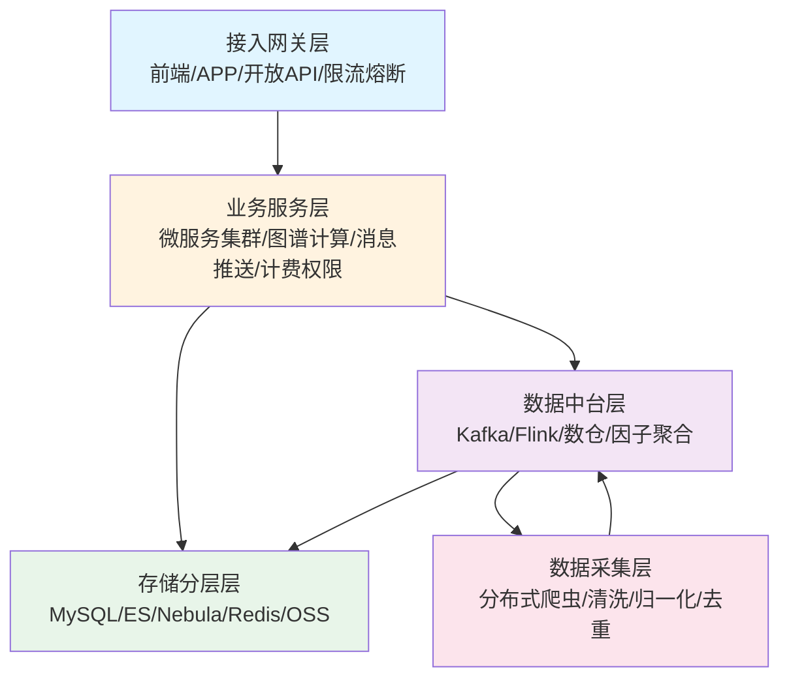
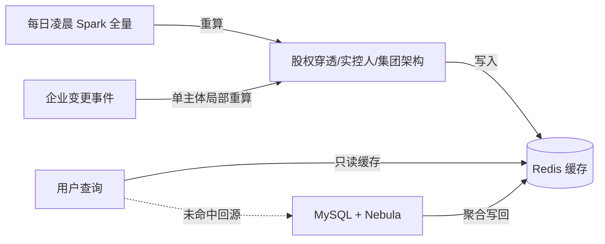
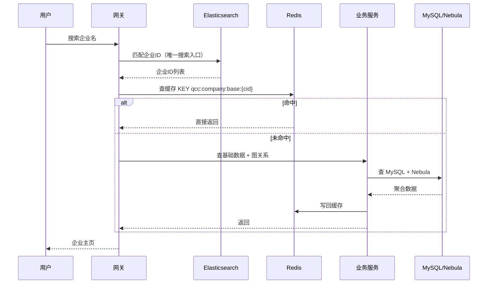
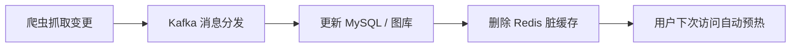

# 企业征信查询平台 系统概要设计说明书（HLD）

> **文档版本**：v1.0
> **文档状态**：基线（Baseline）
> **关联文档**：[SRS 需求规格说明书](./SRS.md) · [LLD 详细设计说明书](./LLD.md)
> **编写说明**：本文档定义系统总体架构、技术选型、分层设计、核心流程与容错降级策略，是架构层（HLD）设计交付物。

---

## 修订记录

| 版本 | 日期 | 修订人 | 说明 |
| --- | --- | --- | --- |
| v1.0 | 2026-10-29 | 架构组 | 首版基线，五层架构 + 存储分层 + 容错降级 |

---

## 目录

1. 总体架构
2. 核心技术栈
3. 分层设计详解
4. 业务微服务拆分
5. 核心业务流程
6. 系统容错与降级
7. 性能优化架构
8. 部署与监控

---

## 1. 总体架构（五层标准架构）

系统采用**五层标准架构**，自上而下职责清晰、各司其职：

| 层级 | 职责 |
| --- | --- |
| 1. 数据采集层 | 分布式爬虫、清洗、归一化、去重 |
| 2. 数据中台层 | Kafka、Flink、数据对齐、数仓、因子聚合 |
| 3. 存储分层层 | MySQL、ES、图数据库、Redis、OSS |
| 4. 业务服务层 | 微服务集群、图谱计算、消息推送、计费权限 |
| 5. 接入网关层 | 前端页面、APP、开放 API、限流熔断 |

---

## 2. 核心技术栈

| 领域 | 选型 | 说明 |
| --- | --- | --- |
| 后端 | Java SpringCloud / Go 微服务 | 混合技术栈，计算密集型用 Go |
| 消息队列 | Kafka | 数据变更事件总线（唯一异步通道） |
| 检索引擎 | Elasticsearch | **唯一搜索入口**，分词/纠错/高亮 |
| 图计算 | NebulaGraph | 股权、任职、投资关系存储与遍历 |
| 缓存 | Redis | 热点聚合、限流、排行榜、图谱结果 |
| 数据库 | MySQL / TiDB | 结构化台账、分库分表 |
| 离线计算 | Spark | 每日全量股权穿透预计算 |
| 部署 | Kubernetes | 容器编排、弹性伸缩 |
| 监控 | Prometheus + Grafana | 指标采集、告警、SLA 看板 |

---

## 3. 分层设计详解

### 3.1 数据采集层

- **数据源**：工商、司法、专利、招投标、舆情等全网公开数据。
- **流程**：抓取 → 标准化清洗 → 字段对齐 → 脏数据剔除 → 变更推送 Kafka。
- **关键点**：变更数据以事件形式驱动全链路更新（CDC 思想）。

### 3.2 存储分层架构（核心亮点）

> 各司其职，大厂标准。**绝不混用**：检索走 ES、关系走图库、台账走 MySQL、热数据走 Redis。

| 存储 | 承担职责 | 典型数据 |
| --- | --- | --- |
| **MySQL / TiDB** | 结构化台账、用户、订阅、计费、企业基础静态数据 | company_info、user、order |
| **Elasticsearch** | 全文检索、模糊匹配、筛选、高亮、纠错 | 企业搜索索引 |
| **Nebula Graph** | 节点（企业/自然人）、边（持股/任职/投资） | 股权穿透图 |
| **Redis** | 热点页面缓存、预计算图谱结果、限流、排行榜 | qcc:company:base:*、qcc:graph:* |
| **OSS** | 文书 PDF、营业执照图片、附件 | 法律文书、执照扫描件 |

### 3.3 计算架构（离线预计算为核心壁垒）

- **离线预计算（核心壁垒）**：每日凌晨全量股权穿透、实控人、集团架构重算。
- **增量实时计算**：企业发生变更，单主体局部重算图谱。
- **结果全部缓存 Redis**：用户查询**不实时跑图遍历**。

### 3.4 业务微服务拆分

| 服务 | 职责 |
| --- | --- |
| 企业基础信息服务 | 工商档案、基础字段聚合 |
| 股东投资图谱服务 | 股权穿透、实控人、集团架构 |
| 司法风险聚合服务 | 诉讼、失信、被执行、行政处罚 |
| 知识产权服务 | 专利、软著、商标 |
| 热搜排行服务 | 热度计算、排行榜 |
| 订阅雷达消息服务 | 监控订阅、变更推送 |
| 会员权限 & 计费服务 | 套餐、权益、API 配额 |
| API 网关限流服务 | 鉴权、限流、熔断、路由 |

---

## 4. 核心业务流程（概要）

### 4.1 查询主流程

### 4.2 数据更新流程

---

## 5. 系统容错与降级

| 场景 | 降级策略 |
| --- | --- |
| 图谱超时 | 只展示直接股东，关闭多层穿透 |
| 搜索过载 | 关闭智能纠错，只保留精准匹配 |
| API 限流 | IP + 账号双层滑动窗口限流 |
| 缓存穿透 | 空值缓存 + 布隆过滤器 |

---

## 6. 性能优化架构

1. **冷热数据分层**：10% 热点常驻缓存，90% 冷门不缓存。
2. **动态 TTL**：热点短 TTL（如 5min）、冷门永久缓存（如 7d）。
3. **预计算替代实时计算**：股权穿透全量离线预算。
4. **读写分离、分库分表**：MySQL 按 company_id 分片。

---

## 7. 部署与监控

- **部署**：Kubernetes 多副本，HPA 弹性伸缩；无状态服务 + 有状态存储分离。
- **监控**：Prometheus 采集 QPS/RT/错误率/缓存命中率；Grafana 看板；AlertManager 告警。
- **SLA**：99.99% 可用率看板，核心接口 P95 红线告警。

---

> **结论**：本 HLD 给出了从采集到接入的五层架构、存储分层方案、离线预计算核心壁垒与容错降级体系，是 LLD 落地实现的架构依据。下一步见 [LLD 详细设计说明书](./LLD.md)。
